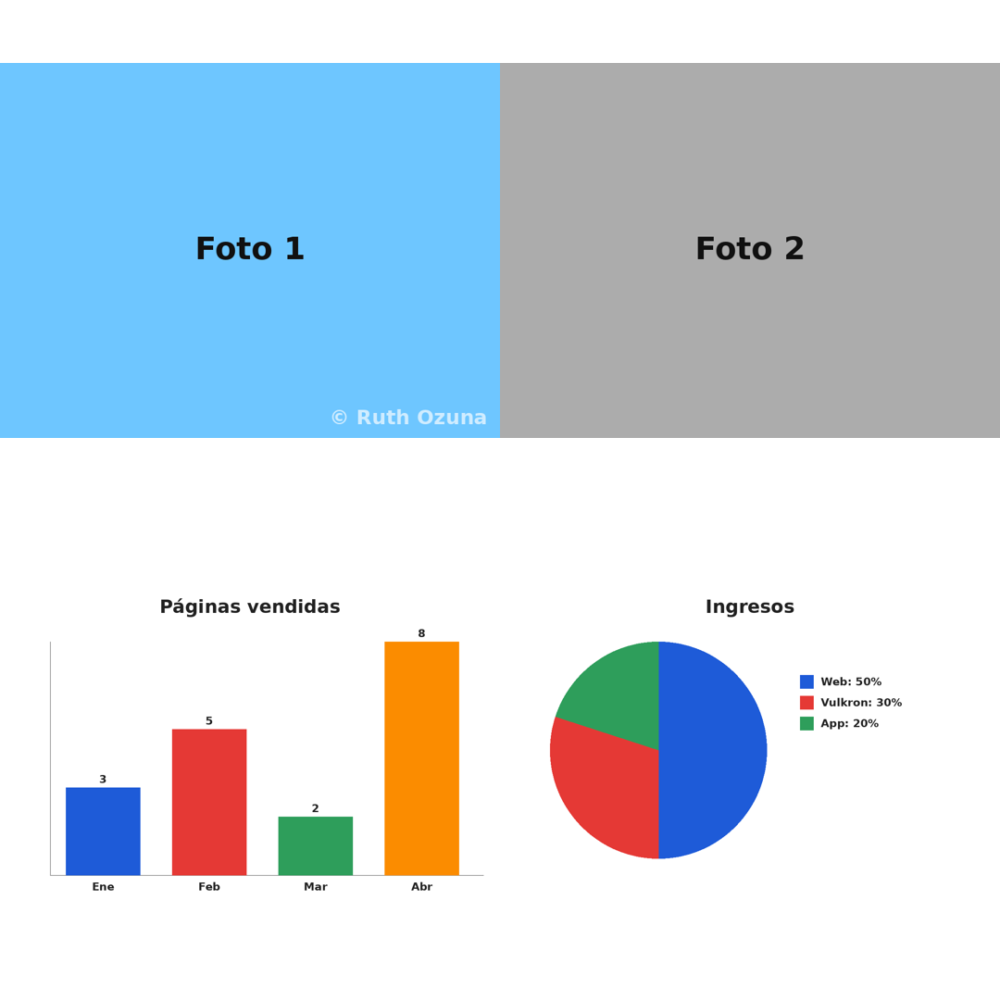

# 💎 Diamante

**Un lenguaje de programación en español, simple como hablar.**
Creado por **Ruth Abigail Ozuna** — Plottier, Neuquén, Argentina.



Diamante está pensado para que cualquier persona pueda automatizar cosas sin saber programar: mostrar mensajes, hacer cuentas, recorrer listas y hasta enviar correos, escribiendo casi como habla.

```
nombre = "Ruth"
mostrar "¡Hola,", nombre + "!"

si edad es mayor o igual que 18:
    mostrar "Sos mayor de edad"
sino:
    mostrar "Sos menor de edad"

para cada empresa en empresas:
    enviar correo a empresa[1] asunto "Hola" mensaje "¿Les interesa una página web?"
```

## Cómo usarlo

Necesitás Python 3 instalado.

```
python diamante.py ejemplos/hola.dia        # ejecuta un programa
python diamante.py                          # consola interactiva
python diamante.py --ver ejemplos/hola.dia  # muestra la traducción a Python
```

## Todo lo que sabe hacer (versión 0.3)

| Diamante | Qué hace |
|---|---|
| `mostrar "hola", nombre` | Muestra en pantalla |
| `nombre = "Ruth"` | Guarda un valor |
| `preguntar "¿Edad?" y guardar en edad` | Le pregunta al usuario |
| `si ... :` / `o si ... :` / `sino:` | Decide |
| `repetir 3 veces:` | Repite |
| `para cada x en lista:` | Recorre una lista |
| `mientras ... :` | Repite mientras se cumpla algo |
| `sumar 1 a contador` / `restar 1 a contador` | Suma o resta |
| `función saludar(nombre):` + `devolver ...` | Crea tus propias funciones |
| `salir` / `seguir` | Corta o salta una vuelta |
| `enviar correo a ... asunto ... mensaje ...` | Envía un correo |

**Comparaciones:** `es igual a`, `es distinto de`, `es mayor que`, `es menor que`, `es mayor o igual que`, `es menor o igual que`, `está en`
**Lógica:** `y`, `o`, `no`, `verdadero`, `falso`, `nada`
**Funciones incluidas:** `largo()`, `texto()`, `numero()`, `aleatorio(a, b)`, `elegir(lista)`, `mayusculas()`, `minusculas()`, `redondear()`, `rango()`, `agregar(lista, valor)`, `suma()`, `maximo()`, `minimo()`

## Superpoderes 💎

| Diamante | Qué hace |
|---|---|
| `crear imagen "cartel.png" de 1080 x 1080 con fondo "plateado" y texto "Hola" en color "negro"` | Crea una imagen para redes |
| `crear video "promo.mp4" con imagenes ["a.png", "b.png"] de 2 segundos cada una` | Arma un video con imágenes |
| `crear qr "qr.png" con "https://mipagina.com"` | Crea un código QR |
| `crear pdf "presupuesto.pdf" con titulo "Presupuesto" y texto "..."` | Crea un PDF |
| `guardar planilla "ventas.csv" con filas` / `leer planilla "ventas.csv" y guardar en datos` | Planillas que se abren con Excel |
| `guardar "hola" en archivo "notas.txt"` / `agregar "chau" al archivo "notas.txt"` | Archivos de texto |
| `leer archivo "notas.txt" y guardar en t` | Lee un archivo |
| `leer página "https://..." y guardar en t` | Lee el texto de una página web |
| `ver clima en "Neuquén" y guardar en c` | Clima actual (Open-Meteo, gratis) |
| `esperar 2 segundos` | Espera |
| `abrir "promo.mp4"` | Abre un archivo o una página |
| `agregar "tarea" a lista` | Suma un elemento a una lista |

**Más funciones:** `hoy()`, `hora()`, `contiene(texto, palabra)`, `reemplazar(texto, a, b)`, `dividir(texto)`, `unir(lista, " ")`

**Colores en español:** plateado, dorado, blanco, negro, gris, rojo, azul, celeste, verde, amarillo, naranja, violeta, rosa, marrón (o cualquier color #RRGGBB).

## Más superpoderes (0.3) 💎

**Nunca se rompe:**
```
intentar:
    leer archivo "datos.txt" y guardar en t
si falla:
    mostrar "No encontré el archivo, pero sigo"
```

| Diamante | Qué hace |
|---|---|
| `crear gráfico "g.png" de barras con etiquetas [...] y valores [...] y título "Ventas"` | Gráfico de barras (o `de torta`) |
| `crear collage "c.png" con fotos [...]` | Junta varias fotos |
| `poner marca de agua "© Ruth" en "foto.png"` | Firma tus fotos |
| `pasar a blanco y negro "foto.png"` / `achicar foto "foto.png" a 800 de ancho` | Editar fotos |
| `agregar música "tema.mp3" al video "video.mp4"` | Video con música |
| `recortar video "v.mp4" desde 5 hasta 15` / `unir videos [...]` | Editar videos |
| `convertir video "v.mp4" en gif` / `sacar audio de "v.mp4"` | GIFs y audio |
| `crear página web "index.html" con título "Mi negocio" y texto "..." y whatsapp "299..."` | Página web lista para subir |
| `ver dólar blue y guardar en d` | Cotización del dólar (también `oficial`, `mep`) |
| `ver datos del país "Alemania" y guardar en p` | Capital, población y moneda |
| `descargar "https://..." como "archivo.pdf"` | Descarga un archivo |
| `ordenar la carpeta "Descargas"` | Ordena por tipo: Imágenes, Videos, Documentos... |
| `renombrar los archivos de "fotos" como "viaje"` | Renombra todo junto |
| `guardar datos ficha en "datos.json"` / `leer datos de "datos.json" y guardar en f` | Guarda fichas de datos |
| `mostrar menú "¿Qué hacemos?" con opciones [...] y guardar en elegido` | Menú interactivo |
| `decir "Hola"` | La computadora habla |

**Fichas:** `cliente = {"nombre": "Ana", "ciudad": "Plottier"}` y después `cliente["nombre"]`

**Matemática:** `raiz()`, `potencia()`, `promedio()`, `mediana()`, `porcentaje(parte, total)`, `calcular_porcentaje(21, 5000)`, `ordenar()`, `invertir()`, `mezclar()`, `sin_repetidos()`, `es_par()`, `es_primo()`, `contar()`, `posicion()`, `primero()`, `ultimo()`

**Texto:** `contar_palabras()`, `capitalizar()`, `quitar_acentos()`, `empieza_con()`, `termina_con()`, `recortar()`, `es_numero()`, `buscar_numeros()`, `generar_contraseña()`, `formato_plata(50000)` → $50.000

**Fechas:** `fecha_larga()`, `dia_de_la_semana()`, `dias_entre(a, b)`, `dias_hasta("31/12/2026")`, `sumar_dias(fecha, 30)`, `edad("15/03/2006")`, `año()`, `mes()`

**Archivos:** `listar_archivos(carpeta, "png")`, `crear_carpeta()`, `copiar()`, `mover()`, `existe()`

## Instalar las herramientas gratuitas

En Windows hacé doble clic en `instalar.bat`. O escribí: `pip install -r requisitos.txt`

## Correos de verdad

Por seguridad, si no configurás nada, Diamante **simula** los envíos. Para enviar de verdad con Gmail, creá una "contraseña de aplicación" en tu cuenta de Google y definí:

```
DIAMANTE_CORREO=tucorreo@gmail.com
DIAMANTE_CLAVE=tu-contraseña-de-aplicación
```

Usalo con responsabilidad: pocos correos, personalizados y a gente que pueda estar interesada.

## Cómo funciona por dentro

Diamante es un **transpilador**: lee tu programa línea por línea, traduce cada instrucción en español a Python y la ejecuta. Si algo falla, te avisa en español y en qué línea está el error.

## Próximamente

- Diamante Pro: la versión potente para programadores.
- Bots para WhatsApp y redes.
- Editor online para probar Diamante desde el navegador.

## Licencia

Diamante es **libre y gratuito**, igual que Python: cualquiera puede usarlo, estudiarlo y mejorarlo, siempre que mantenga el aviso de autoría (licencia MIT).

Copyright © 2026 Ruth Abigail Ozuna. El nombre "Diamante 💎" identifica al proyecto original creado por Ruth Abigail Ozuna; las versiones modificadas por otras personas no pueden presentarse como la versión oficial.

Hecho con 💎 en Plottier, Neuquén.
